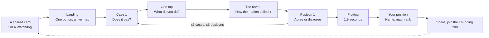
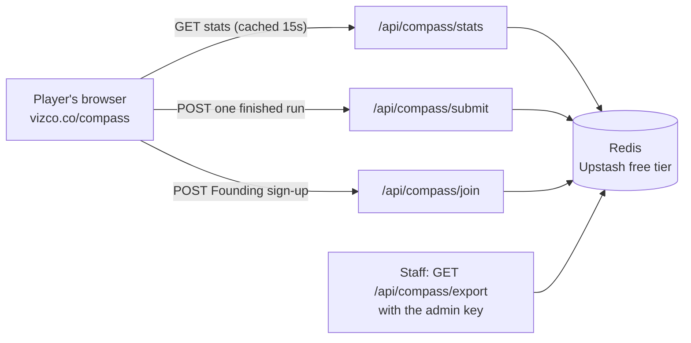

# The AI Cover Compass: concept, experience and build

22 Nov 2026 · @Tanay. Replaces "Covered? (working title)" of 20 Nov 2026.

**Status:** the MVP is built and lives at `vizco.co/compass` on the main website (branch `feature/gracious-cerf-j473bz`). It needs a free Redis database and a merge to go live; see [To go live](#to-go-live).

## Summary

The AI Cover Compass is a free, four-minute game for insurance professionals that turns the silent AI argument into a live poll. Players make six calls on real-world AI losses ("Does it pay?"), take six positions on where AI cover should go, and land on a map of the market with a named position they want to share: Gap Hunter, Steady Hand, Watchdog, Architect or Arbiter.

Two questions decide where you stand:

1. **Do today's policies pay for AI losses?** (left to right)
2. **Should they?** (bottom to top)

The insight from the last plan still holds: **if insurance professionals can't agree whether a policy pays, that policy is silent.** Every call measures that disagreement. Every position records where professionals think AI cover should go. At 200 players, that is the first public, vetted read of both.

## What changed since 20 November

| | 20 Nov plan | Now | Why |
| --- | --- | --- | --- |
| Name | Covered? | **The AI Cover Compass** ("Does it pay?" stays as the question in every case) | The result is a position on a map. "Compass" says so instantly and makes the share line write itself: "I'm a Gap Hunter on the AI Cover Compass." |
| Where | Separate app at covered.vizco.co | A page on the main site: `vizco.co/compass` | The brief: on the main website. Every play builds the site's authority, not a subdomain's. |
| Mechanic | A verdict survey with a per-round reveal | Political-compass map, five named positions, rankings, shareable result, plus the per-case reveal | People play to see where they land and how they're categorised. |
| Scope | 60 reviewed rounds, seven-week build | MVP: 6 cases, 6 positions, 1 question for the report. Built. | Ship, learn from early players, then grow. |
| Target | Thousands of players; 100 votes per round to publish | **200 players.** Everyone answers every item, so 200 players means 200 votes on each case | A fixed set makes a small panel statistically useful. Rotation comes later. |
| Early adopters | Optional sign-in for a streak | **The Founding 200**: named in the first report, early results, a direct line for feedback | Being early is the reward, which solves the empty-room problem. |
| Tech | Next.js app, Postgres, 12 tables, separate hosting | Three API routes on the existing site and one free Redis database. No new packages. | Storage is a detail. The experience is the product. |
| Content rules | Line names allowed; insurers possibly named | The website's rules apply: no insurer names, no policy-type names, no figures. Wordings are VizCo specimens unless a source is linked. | It's on the main site now. |

## The north star

From the brief, kept in front of every decision:

- **Engaging, and useful to the whole industry.** Professionals should find it interesting enough to play and to talk about.
- **A poll that grows.** More players, more data; the data is the point.
- **Identity and rank.** People come back to see where they rank and how they're categorised, the way the Political Compass and BuzzFeed quizzes in their heyday made people share.
- **Early adopters are partners.** Special mentions, and their feedback makes it more robust.
- **It becomes a framework.** The map and the data turn into a report (PDF), then more.
- **The dream:** more than 200 people play, giving real, vetted data on what professionals think about where AI insurance should go.

## Why it works

Each part borrows one proven mechanic and points it at a real professional question.

| Borrowed from | The mechanic | In the Compass |
| --- | --- | --- |
| The Political Compass | Two axes, one dot, "where do you stand?" | Today's wording against where cover should go; your dot among everyone else's |
| BuzzFeed quizzes | An identity worth posting: a name, a line, a quote | Five positions, each with a line and "Most likely to say" |
| "Survey says" game shows | The crowd's answer revealed after yours | The market's split after every case, by role |
| Wordle | Everyone plays the same set, so results compare and travel | One fixed set in v1; a share card that names your position |

## The map

| Position | Where | The line | Most likely to say |
| --- | --- | --- | --- |
| **The Gap Hunter** | Doesn't pay · Fold AI in | You see AI losses falling through today's wording, and you want standard cover to close the gap. | "Show me where it says AI." |
| **The Steady Hand** | Pays · Fold AI in | To you, AI is one more way things go wrong. Today's policies respond, and that's how it should stay. | "We said the same about the internet." |
| **The Watchdog** | Pays · Carve AI out | You think today's policies are quietly paying for AI risk nobody planned for, and it needs fixing before a big loss fixes it for everyone. | "Silent cover is still cover." |
| **The Architect** | Doesn't pay · Carve AI out | You read today's wording as leaving AI out, and you think that's right: AI is a new risk that deserves cover built for it. | "New risk, new policy." |
| **The Arbiter** | The centre | You weigh every word and won't call it early. For you, AI cover turns on the facts and the wording, case by case. | "It depends. Send me the full policy." |

The map is the framework. It separates what people think policies **do** from what they think policies **should** do, which is exactly where the market's argument gets tangled.

## The experience, moment by moment

This is the heart of the plan: what the player sees, what they should feel, and the design choices that make them feel it. All of it is built.

| # | Moment | What they see | What they should feel | Choices that make it happen |
| --- | --- | --- | --- | --- |
| 1 | **The link** | A colleague's LinkedIn post: a card reading "I'm a Watchdog", the map with one orange square | "Which one am I?" | Each position has its own share image and landing page ("Someone you know is a Watchdog"), so every share is an invitation, not a boast |
| 2 | **Landing** (first 10 seconds) | "Where do you stand on AI cover?", one black button, "4 minutes · Anonymous · No sign-up", a live count, and the map with a "YOU?" marker drifting between positions | "This is for me, and it's quick" | One action only. The drifting marker teases the payoff. The live count is real or hidden, never invented |
| 3 | **The first case** | A full-screen stage: a real-world loss in three sentences, the policy in plain words, the wording on a paper card, defined terms spelled out, the source linked | "I know this problem. I have a view." | Professional respect: real cases, specimen wording that reads like the market, sources beside the claim. The crux in one line ("Is a chatbot 'anyone'?") |
| 4 | **The call** | Three big tiles: Yes, Arguable, No | Confident, quick | Same three answers the home page already teaches. Arguable is a real answer, not a cop-out. Keys 1, 2, 3 on desktop; a tiny buzz on Android |
| 5 | **"What do you do?"** | After the first call only: eight role chips, five optional regions, "Show me the split" | A fair trade | Asked once, after commitment and before the reward. Never before the first vote |
| 6 | **The reveal** | Bars that grow, "You" marked, a split score ("98/100, contested"), how their peers called it, then "Our reading", labelled as one reading | "Ooh." Surprise, sometimes vindication | Vote first, crowd second, so nobody anchors. If they disagree with us: "You read it differently. That's what the poll is for." Nobody is ever marked wrong |
| 7 | **A position** | One statement, big. Four tiles from Strongly disagree to Strongly agree; no middle | Momentum | One tap, a glance at "64% agree so far", then it moves on by itself (2.4 seconds, with a visible timer; off for reduced motion) |
| 8 | **One for the report** | "Every policy should say clearly whether it covers AI." Not scored | "My voice counts" | The poll's purpose made visible. It is also the cleanest headline the report can carry |
| 9 | **Plotting** | Crosshairs and a pulsing orange square: "Plotting your position. Against everyone who's played." | Anticipation | A deliberate 1.9-second pause while the run is saved and fresh numbers load |
| 10 | **The result** | "You're a **Gap Hunter.**" in the site's black block, wiping in. The line, the quote, three traits. The map draws itself; the crowd fades in; your square drops into place; role averages appear | Recognition: "That's me" | The block-highlight reveal is the brand's own device. The dot lands among real players, so the identity is relative, not a horoscope |
| 11 | **The numbers** | "You think policies pay more often than 51% of players." "Your boldest call: only 31% called the chatbot case your way." "Closest to you: the average broker." | Rank and curiosity | Rankings only once 20 people have played; until then it says how many to go. Honest numbers make the game worth trusting |
| 12 | **Share** | "I'm a Gap Hunter. Where do you stand?" Share on LinkedIn, Copy post (first person, ready to paste), Copy link, native share on phones | Pride, and a little challenge | The post is pre-written so sharing takes five seconds. The link shows the position, never the answers |
| 13 | **The Founding 200** | A black panel: "Player #37 · Founding window open. Join the Founding 200." Name, work email, company, "What should we add or fix?" | Belonging | Credit in the first report (opt-in), results first, a direct line to the team. The email doubles as the vetting signal |
| 14 | **The close** | "Want to know how your own policies read? Talk to us." Play again | No pressure | One quiet call to action, after the value, never before |
| 15 | **Coming back** | "Welcome back. You're The Gap Hunter." See your result, or play again | Remembered | The browser remembers the result. Replays never change the numbers |

### Principles behind the feel

- **Compare, never grade.** There are no right answers. Our reading is shown and labelled; players are compared only with each other.
- **Vote first, then see the crowd.** Always.
- **Respect the reader.** Real cases, defined terms spelled out, sources linked, a plain disclaimer. Nothing cute that undermines the substance.
- **Honest numbers or none.** Splits show from 5 calls and are greyed as an "early read" under 30. Rankings from 20 players. Role averages from 5 per role. Without live storage, numbers are hidden, not faked.
- **Fast.** Twelve calls in about four minutes. Phone first, with keyboard play on desktop.
- **On brand.** Paper and ink, orange only as a signal (your square, progress, small marks), the black "Co" block as the reveal.
- **Accessible.** Real radio buttons, keyboard throughout, focus moved to each new step, live regions for reveals, reduced motion respected, colour never the only signal.

## The content of v1

Six cases, balanced so the market's answers can genuinely split: two where our reading leans "pays", two "arguable", two "doesn't pay".

| # | Case | Based on | The crux | Our reading |
| --- | --- | --- | --- | --- |
| 1 | The chatbot's promise | Moffatt v. Air Canada, 2024 | Is a chatbot "anyone", or simply "you"? | Pays |
| 2 | The wet-floor sign | A question raised on an industry panel, Nov 2026 | The AI made the sign. Did the sign cause the fall? | Pays |
| 3 | The deepfake call | A reported 2024 case in Hong Kong | Did a natural person impersonate anyone, or did software? | Arguable |
| 4 | The hiring screen | Mobley v. Workday, 2025 | Does a discrimination exclusion reach a tool sold to others? | Doesn't pay |
| 5 | The unchecked report | Illustrative | The AI invented the studies; a person skipped the check. Which caused the loss? | Doesn't pay |
| 6 | The talked-round agent | Illustrative | The fraudsters typed in; the agent chose to pay. Is that "directly"? | Arguable |

Six positions on where cover should go, half phrased each way to avoid "agree with everything" bias:

| Topic | Statement | Agreeing means |
| --- | --- | --- |
| Silence | If a policy says nothing about AI, it should pay for AI losses. | Fold in |
| Freedom to exclude | Insurers should be free to exclude any loss with a link to AI. | Carve out |
| Its own cover | AI risk should be sold as its own cover, not folded into existing policies. | Carve out |
| Cause, not connection | An AI exclusion should only apply when the AI actually caused the loss. | Fold in |
| Unplanned risk | Insurers shouldn't have to pay for AI risk they never underwrote. | Carve out |
| Just a tool | AI is a tool like any other. Policies should treat it that way. | Fold in |

Plus one unscored question for the report: *Every policy should say clearly whether it covers AI.*

All content lives in `src/content/compass.ts`. Editing a scored item changes what its votes mean, so bump `COMPASS.version` when you do; votes are kept under the version they were cast on.

## How a position is worked out

- **x** (today's wording): the average of the six calls, with Yes = +1, Arguable = 0, No = -1.
- **y** (where cover should go): the average of the six positions, with Strongly disagree to Strongly agree scored -1, -1/3, +1/3, +1, flipped for "carve out" statements.
- Within 0.25 of the centre: **the Arbiter**. Otherwise the quadrant decides. An all-Arguable reading (x = 0) counts as "doesn't clearly pay".
- The server recomputes every position from the raw answers; it never trusts the browser's maths.

| Shown | From | Below that |
| --- | --- | --- |
| A case's split | 5 calls (greyed as an early read under 30) | "You're one of the first to call this case" |
| Your peers' split | 5 calls from your role | Hidden |
| Rankings (percentiles) | 20 players | "Unlocks at 20 players. N to go" |
| Boldest call, calls with the majority | 10 calls on every case | Hidden |
| Role averages on the map | 5 players per role | Hidden |
| Where everyone landed | 10 players (early read under 30) | "You're early" |

## Method and honesty

Unchanged in spirit from the last plan, sized for 200 players.

| We will say | We will never say |
| --- | --- |
| "Professionals who played split 42/31/27 on this case" | "This clause doesn't cover AI" |
| "Claims professionals were twice as likely as brokers to say No" | "The market thinks" (players are a self-selected panel) |
| "Our reading is X, for these reasons" | That our reading is the answer, or legal advice |

- **One run per player counts.** A random ID in the browser, checked on the server. Replays get a result but don't move the numbers.
- **Runs faster than 25 seconds** are kept apart and not counted.
- **Not in insurance** is a role of its own and is reported separately, never mixed into professional figures.
- **Vetted cut.** Founding members give a work email, so the report can show "all players" and "verified professionals" side by side.
- **In the report:** 95% intervals on every share; role cuts only with at least 20 players in that role; method and thresholds published with the results.

## The tech: deliberately simple

No AI model runs while people play. It is a page, three small API routes and one database.

| Piece | Where | Notes |
| --- | --- | --- |
| Page and game | `src/app/compass/page.tsx`, `src/components/compass/` | The hero and stage are one client component (`CompassGame`); the sections below are static |
| Content | `src/content/compass.ts` | Cases, positions, roles, positions on the map, all copy |
| Scoring | `src/lib/compass/score.ts` | Shared by browser and server |
| Storage | `src/lib/compass/store.ts` | Upstash Redis over its REST API (plain `fetch`, no package). Without it: an in-memory store for local play, and live numbers hidden in production |
| API | `src/app/api/compass/{stats,submit,join,export}` | Validated by hand; rate-limited per caller |
| Share pages and images | `src/app/compass/you/[slug]/`, `src/lib/compass/og.tsx` | One landing page and one share image per position, built at deploy time with Inter (subset, in `src/lib/compass/fonts/`) |

**What is stored.** Per run: the random player ID, time, role, region, answers, position, position name and duration. No name and no IP address: a daily-salted hash of the caller's network is used only for the hourly rate limit and expires within the hour. Founding sign-ups (email, optional name and company, credit preference, feedback) sit in a separate list.

**Abuse checks in v1.** One count per player ID, 12 runs an hour per network, fast runs set aside, a hidden field on the sign-up form. Cloudflare Turnstile is the next step if needed.

**Cost.** The site is already on Vercel. Upstash's free tier covers this many times over.

## To go live

1. **Add the database.** In Vercel: Storage, then Marketplace, then "Upstash for Redis" (free), connected to the website project. It sets `KV_REST_API_URL` and `KV_REST_API_TOKEN`; the code reads those (or `UPSTASH_REDIS_REST_URL` and `UPSTASH_REDIS_REST_TOKEN`).
2. **Set two variables:** `COMPASS_SALT` (any random string) and `COMPASS_ADMIN_KEY` (a long random string, for the export).
3. **Merge and deploy.** Then play once on the live site and check that `vizco.co/api/compass/stats` shows `"live": true` and one player.
4. **Pilot with 10 to 20 friendly professionals** before any public post. Watch for cases people misread; fix and bump the version if a scored item changes.
5. **Turn on the entry points** (decision 2): the announcement strip, a home page panel, the nav.
6. **Counsel.** A short privacy notice for the Compass (the site's privacy policy covers only the VizCo Chat app); a check on the disclaimer and on naming real cases.
7. **Export the data** any time: `curl -H "Authorization: Bearer $COMPASS_ADMIN_KEY" https://vizco.co/api/compass/export`.

## Launch and buzz

The aim is 200 completed runs, and a reason for each of them to bring one more.

| Phase | When | What happens | The hook |
| --- | --- | --- | --- |
| 0. Pilot | Week of launch | 10 to 20 friendly professionals play and give feedback through the Founding form | "You're seeing it before anyone else" |
| 1. Founding 200 | Launch week | Each founder posts their own position on LinkedIn with the pre-written post; 50 personal messages to brokers, underwriters, claims and coverage lawyers; partners share | "I'm a Watchdog. Where do you stand?" and a counter of places left |
| 2. First results | At 100 players | A short post with the most contested case, by role, once it clears the thresholds | "Brokers and claims read the same words differently" (with the real numbers) |
| 3. The Founding report | At 200 players | The first AI Cover Compass report as a PDF: the map, every split, the method, the Founding 200 credited by name | The framework, with data nobody else has |
| 4. Live | First conference after launch | The room plays from phones via a QR code; the map fills on the big screen | Watching the room land |

The headline the data can earn is of the form "X of 6 AI loss scenarios are contested among professionals" and "N% of professionals want every policy to say clearly whether it covers AI". The numbers come only from real votes.

## Roadmap: MVP, then next versions

| Version | What | Why |
| --- | --- | --- |
| **v1 (built)** | 6 cases, 6 positions, 1 report question; reveal; role picker; result with map, rankings and share; Founding 200; share pages and images; export | The smallest thing that delivers identity, rank, buzz and data |
| v1.1 | A "started" counter for completion rate; Turnstile if bots appear; fixes from the pilot; a results page per case | Know where people drop off; keep the data clean |
| v2 | **Team compass** (a link for one firm, to compare a team's spread); the Reach Ladder (one exclusion, eight rungs from core to peripheral AI); a confidence tap; "Is this an AI claim?" scale; new cases rotated monthly; real public wordings once counsel clears quoting | Teams challenging each other is the strongest second wave of buzz |
| v3 | The report and PDF on a quarterly rhythm; open aggregate data; live mode for conferences; the Daily Case | The framework becomes the market's reference |

## Measuring success

| Measure | Target for the first month |
| --- | --- |
| Completed runs with a role | 200 (the dream), at least 120 from insurance roles |
| Start to result | 60% or more (needs the v1.1 counter) |
| Founding sign-ups | 25% of insurance players |
| Shares | Watched through LinkedIn and referral traffic in analytics |
| Feedback | Every Founding comment read; the pilot's top three fixes shipped |

## Risks

| Risk | Mitigation |
| --- | --- |
| Too few players | Founders and partners post their own positions; the Founding counter creates urgency; the share card does the asking |
| Our reading is wrong in public | Labelled as one reading; a coverage specialist reviews cases before v2; versioned content and a visible corrections note |
| Brigading or bots | One count per player, rate limits, fast runs set aside, roles reported separately, Turnstile ready |
| "It's just a survey" | Say so plainly; publish sample sizes and the method; a verified-professional cut |
| Arguable becomes the safe answer | It's a real signal of silence, reported as such; the positions have no middle option |
| Insurers object | No insurer is named; wordings are specimens; we report votes, never verdicts on anyone's conduct |

## Open decisions

| # | Decision | Options | Recommendation |
| --- | --- | --- | --- |
| 1 | Name | The AI Cover Compass; Covered?; The Coverage Compass | **The AI Cover Compass.** One constant in `src/content/compass.ts` if we change it |
| 2 | Entry points on the site | Announcement strip; home page panel; nav item | Swap the announcement strip to the Compass for launch weeks, then add a home panel |
| 3 | Policy-type names in cases | Keep the site rule; allow them in the Compass | Keep the rule for v1; revisit if pilots find the cases too vague |
| 4 | Real wordings | Specimens; quote public forms | Specimens for v1; counsel before quoting public forms in v2 |
| 5 | Founding credit | Opt-in name; no names | Opt-in, ticked by default, clearly worded (as built) |
| 6 | Report name | The AI Cover Compass report; The Silent AI Index | The AI Cover Compass report, so the game and the output share one brand |

## Kept from the 20 November plan, and parked

- **Kept:** disagreement as the measure of silence; vote first, then the crowd; VizCo's reading labelled as one reading; the honesty rules; never inventing data; the partner list (coverage counsel, the trade press, conference organisers, professional bodies, the wholesale partner, an academic reviewer).
- **Parked for later versions:** the separate app and its 12-table Postgres schema, the 60-round bank, the Reach Ladder at launch, sign-in with LinkedIn, live mode at launch, the Daily Claim.

## Sources

- [Moffatt v. Air Canada, 2024 BCCRT 149 (summary by McCarthy Tétrault)](https://www.mccarthy.ca/en/insights/blogs/techlex/moffatt-v-air-canada-misrepresentation-ai-chatbot)
- [CNN, report on the deepfake video-call fraud at Arup's Hong Kong office, 16 May 2024](https://edition.cnn.com/2024/05/16/tech/arup-deepfake-scam-loss-hong-kong-intl-hnk/index.html)
- [Mobley v. Workday, collective action allowed May 2025 (summary via Mondaq)](https://www.mondaq.com/unitedstates/new-technology/1630454/federal-court-allows-collective-action-lawsuit-over-alleged-ai-hiring-bias)
- [MoneyGeek, quoting the standard generative AI exclusion definition](https://www.moneygeek.com/insurance/business/general-liability/generative-ai-exclusion/)
- [Insurance Business, review of standard AI exclusions and state filings](https://www.insurancebusinessmag.com/us/news/cyber/isos-generative-ai-exclusion-is-already-on-thousands-of-cgl-policies-589971.aspx)
- [Bank of England PRA SS4/17, the precedent for measuring silent exposure](https://www.prarulebook.co.uk/guidance/supervisory-statements/ss04-17-cyber-insurance-underwriting-risk)
