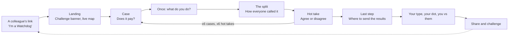
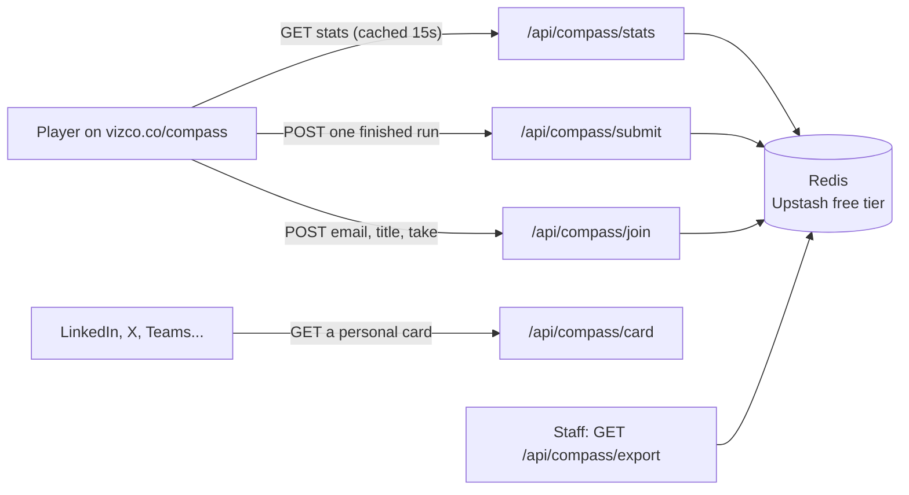

# The AI Cover Compass: concept, experience and build

23 Nov 2026 · @Tanay. Replaces "Covered? (working title)" of 20 Nov 2026. Revised after the first review of the built MVP.

**Status:** built and live on the branch preview at `/compass` (branch `feature/gracious-cerf-j473bz`). It needs a free Redis database and a merge to go live; see [To go live](#to-go-live).

## Summary

The AI Cover Compass is a free, four-minute game for insurance professionals that turns the silent AI argument into a live poll. Players make six calls on real AI losses ("Does it pay?"), take six quick sides on where AI cover should go, and land on a map of the market as one of five types: Gap Hunter, Steady Hand, Watchdog, Architect or Arbiter. Then they challenge a colleague and see exactly where they agree.

Two questions decide where you stand:

1. **Do today's policies pay for AI losses?** (left to right)
2. **Should they?** (bottom to top)

The insight from the first plan still holds: **if insurance professionals can't agree whether a policy pays, that policy is silent.** Every call measures that disagreement. Every side taken records where professionals think AI cover should go. It is a survey, not a test: there are no right answers and no house view on any case.

## What changed in this revision

| | First build | Now | Why |
| --- | --- | --- | --- |
| Where it plays | A full-screen stage over the page | **Inside the page.** Nav and footer stay; a progress bar sticks under the header; the landing sections step aside while you play | It should feel like part of vizco.co, not a separate app |
| Our view | "Our reading" after each case | **Removed.** Players see only how everyone else called it | Too opinionated for a survey |
| Cases | A paragraph, a policy description, a clause, a definition, a note | **A two-line story, one line of wording with the key phrase highlighted, and "the catch" in one question** | Simple travels. Every extra line loses people on a phone |
| Statements | Careful, formal | **Hot takes**, short and quotable ("AI is just a tool. Insure it like any other.") | Quotable statements get argued about, and argument is distribution |
| Answer colours | Black and white | **Red to green** for Strongly disagree to Strongly agree; green, amber, red for Yes, Arguable, No; always with an icon and a label | Instantly legible, and colour is never the only signal |
| Email | An optional Founding form at the very end | **A last step before the result:** work email, then optional name, job title and a one-line take on AI cover. Skippable | Asked at peak curiosity, where it converts best |
| Overall results | A breakdown of every type on the result screen | **Deferred.** "The full results come to you by email, and we'll publish them here" | Results become an event of their own: a second wave of attention |
| Sharing | LinkedIn and copy | **LinkedIn, X, WhatsApp, Teams, email, copy link, copy post, and the phone's share sheet.** Each share carries a personal card with your own dot, and doubles as a challenge | See the next section |

## Built for 10,000 players: how it spreads by itself

The question isn't how to market the Compass. It's how to make it worth talking about, so the people who play do the marketing. That's the core of *Purple Cow*: build something remarkable, aim it at the people who spread ideas, and make it easy for them to do so.

| Purple Cow principle | What it means here | What's built |
| --- | --- | --- |
| **Remarkable or invisible.** Safe is risky | Every other AI-insurance survey is a PDF nobody shares. This one gives you an identity and a fight | Five named types; hot takes with no middle option; "Bold call. Only 18% agree with you." |
| **Find the sneezers** | In insurance, the people who spread ideas are the ones who post opinions on LinkedIn and argue in team chats: brokers, coverage lawyers, claims leads | Share buttons for exactly those places, including Teams and WhatsApp, where firms actually talk |
| **Make it easy to spread** | Sharing should take five seconds and look good | A first-person post already written; a share card with *your* dot (no two cards are alike); one link per player |
| **Give the sneezer a reason** | People share what makes them look sharp, rare or right | "How rare you are: 9% of players are Architects." "Your boldest call." "Most brokers are Steady Hands. You're the exception." |
| **Build the loop into the product** | Every share should bring someone back to play | The share link is a **challenge**: your colleague plays the same calls and sees "You agree on 7 of 12 calls", with both dots on the map |
| **Otaku: serve the obsessives** | Coverage nerds want depth | Real cases with sources, the split by role after every call, the divisive-case board on the landing |
| **Keep it fresh** | Remarkable fades | The results drop (by email first, then published) is a second launch; new cases in v2; team challenges |

### What 10,000 players looks like

- **The first minute is social proof:** a live counter, the map filling with grey dots, and "Most divisive so far: The talked-round refund bot, 35% Yes · 33% Arguable · 32% No".
- **Every call has a crowd:** after each case, a large sample shows how every role split. That's the moment people screenshot.
- **Identity is relative:** your type matters because of who else landed there. Rarity and "most brokers are..." only mean something at scale, which is why they switch on at 20 players.
- **Firms play together:** one person's challenge link goes round a team chat; the team's dots end up together on the map. Team compasses are v2.
- **The results are an event:** at 200 and again at 1,000 and 10,000, the published results give everyone a reason to post again ("I was in the 12% who said the deepfake call pays").

## The map

| Type | Where | The line | Most likely to say |
| --- | --- | --- | --- |
| **The Gap Hunter** | Doesn't pay · Fold AI in | You see AI losses falling through today's wording, and you want standard cover to close the gap. | "Show me where it says AI." |
| **The Steady Hand** | Pays · Fold AI in | To you, AI is one more way things go wrong. Today's policies respond, and that's how it should stay. | "We said the same about the internet." |
| **The Watchdog** | Pays · Carve AI out | You think today's policies are quietly paying for AI risk nobody planned for, and it needs fixing before a big loss fixes it for everyone. | "Silent cover is still cover." |
| **The Architect** | Doesn't pay · Carve AI out | You read today's wording as leaving AI out, and you think that's right: AI is a new risk that deserves cover built for it. | "New risk, new policy." |
| **The Arbiter** | The centre | You weigh every word and won't call it early. For you, AI cover turns on the facts and the wording, case by case. | "It depends. Send me the full policy." |

The map is the framework: it separates what people think policies **do** from what they think policies **should** do, which is where the market's argument gets tangled.

## The experience, moment by moment

| # | Moment | What they see | What they should feel | Choices that make it happen |
| --- | --- | --- | --- | --- |
| 1 | **The link** | A colleague's post: a card with their type and their own dot | "Which one am I? Would I land near them?" | Personal cards; the shared page says "You've been challenged" and "Take the challenge" |
| 2 | **Landing** | "Where do you stand on AI cover?", a challenge banner if they came from a link, one button, a live counter, the most divisive case so far, the map with a drifting "YOU?" | "This is quick, and people are arguing about it" | One action. Real numbers or none |
| 3 | **A case** | Inside the site, nav visible. A two-line story, one line of policy wording with the key phrase in the black block, "The catch" in one question | "I know this. I have a view." | Nothing to wade through. Real cases sourced in one small line |
| 4 | **The call** | Three coloured tiles: green Yes, amber Arguable, red No | Decisive | Colour, icon and label together. Keys 1, 2, 3 on desktop |
| 5 | **"What do you do?"** | After the first call only: role chips, optional region | A fair trade | Asked once, after commitment, before the reward |
| 6 | **The split** | "You're with the 62%." or "Bold call. Only 18% agree with you.", coloured bars, a split score, how their own role called it | Surprise, sometimes vindication | Vote first, crowd second. No house view |
| 7 | **A hot take** | A short, quotable statement; four coloured tiles from red Strongly disagree to green Strongly agree, with thumbs | Momentum | One tap, a glance at the four-colour split, then it moves on by itself |
| 8 | **Last step** | "Where should we send the results?" Work email; optional name, job title, one-line take; a checkbox for credit; "Skip, just show my result" | "Of course, I want the results" | Asked at peak curiosity, never forced. Returning players who already gave an email skip it |
| 9 | **Plotting** | Crosshairs and a pulsing square | Anticipation | 1.9 seconds while the run saves |
| 10 | **Your type** | "You're a **Gap Hunter.**" wipes in; the map draws; the crowd fades in; your dot drops; role averages appear | "That's me" | The brand's own black-block reveal |
| 11 | **Worth posting** | How rare you are; your boldest call; what your role tends to be; if challenged, "You agree on 7 of 12 calls" with both dots and the case you split on | Pride, curiosity, a little rivalry | Each line is a ready-made talking point |
| 12 | **Share and challenge** | "Who do you know that would land somewhere else?" LinkedIn, X, WhatsApp, Teams, email, copy link, copy post, more; a preview of their personal card | "I have to send this to Sam" | Five seconds to share; the link is the challenge |
| 13 | **The results** | "The full results are coming to you", or a compact email form if they skipped | Anticipation for the drop | The results are a second event, not a footnote |
| 14 | **The close** | "Want to know how your own policies read? Talk to us." Play again. Feedback link | No pressure | One quiet call to action, after the value |

### Principles behind the feel

- **A survey, not a test.** No right answers, no house view, nobody scored right or wrong.
- **Vote first, then see the crowd.** Always.
- **Simple wins.** One story, one line of wording, one question.
- **Honest numbers or none.** Splits show from 5 calls, marked "early read" under 30. Rarity from 20 players. Role averages from 5 per role. Without live storage, numbers are hidden, not faked.
- **Part of the site.** Nav, footer and the site's paper-and-ink style; orange stays the signal for "you" and progress.
- **Accessible.** Real radio buttons, keyboard play, focus moved to each new step, live regions for reveals, reduced motion respected, colour never the only signal.

## The content

Six cases, chosen so the market can genuinely split. Each wording line is a simplified specimen in the style of common market language.

| # | Case | The policy says | The catch | Based on |
| --- | --- | --- | --- | --- |
| 1 | The chatbot's promise | We cover mistakes made by you, or by **anyone you're responsible for**. | Is a chatbot "anyone"? | Moffatt v. Air Canada, 2024 |
| 2 | The wet-floor sign | We don't cover injury **arising out of generative AI**. | AI made the sign. Did the sign cause the fall? | An industry panel, Nov 2026; the standard AI exclusion |
| 3 | The CFO who wasn't there | We cover money lost to **a person impersonating** your staff. | Is a deepfake "a person"? | A reported 2024 case in Hong Kong |
| 4 | The hiring bot | We don't cover **any claim of discrimination**. | Written for the company's own hiring. Does it reach a tool it sells? | Mobley v. Workday, 2025 |
| 5 | The made-up studies | We don't cover any claim **arising from the use of AI**. | AI invented the studies. A person didn't check. Which caused the loss? | Illustrative |
| 6 | The talked-round refund bot | We cover money lost **directly** to fraud on your computer systems. | The bot chose to pay. Is that "directly" fraud? | Illustrative |

Six hot takes, half phrased each way to avoid "agree with everything" bias:

| Topic | Hot take | Agreeing means |
| --- | --- | --- |
| Silence | If a policy is silent on AI, it should pay. | Fold in |
| Freedom to exclude | Insurers should be free to exclude anything AI touches. | Carve out |
| Its own cover | AI needs its own insurance, separate from everything else. | Carve out |
| Cause, not connection | An AI exclusion should only bite when AI caused the loss. | Fold in |
| Unplanned risk | If insurers never planned for AI, they shouldn't have to pay for it. | Carve out |
| Just a tool | AI is just a tool. Insure it like any other. | Fold in |

Plus one unscored question for the report: *Every policy should say clearly whether it covers AI.*

All content lives in `src/content/compass.ts`. Editing a scored item changes what its votes mean, so bump `COMPASS.version` (now `v2`); votes are kept under the version they were cast on.

## How a type is worked out

- **x** (today's wording): the average of the six calls, Yes = +1, Arguable = 0, No = -1.
- **y** (where cover should go): the average of the six hot takes, Strongly disagree to Strongly agree scored -1, -1/3, +1/3, +1, flipped for "carve out" statements.
- Within 0.25 of the centre: **the Arbiter**. Otherwise the quadrant decides. An all-Arguable reading counts as "doesn't clearly pay".
- The server recomputes every position from the raw answers.
- **Challenges** compare two players on all twelve scored calls: the same verdict on a case, the same side on a hot take.

| Shown | From | Below that |
| --- | --- | --- |
| A case's split | 5 calls ("early read" under 30) | "You're one of the first to call this case" |
| Your role's split | 5 calls from your role | Hidden |
| How rare you are | 20 players | "You're one of the first to land here" |
| Your boldest call | 10 calls on every case | A nudge to challenge a colleague |
| What your role tends to be | 5 players in your role | Hidden |
| Role averages on the map | 5 players per role | Hidden |
| Most divisive case (landing) | 30 calls on a case | Hidden |

## Method and honesty

| We will say | We will never say |
| --- | --- |
| "Professionals who played split 35/33/32 on this case" | "This clause doesn't cover AI" |
| "Claims professionals were twice as likely as brokers to say No" | "The market thinks" (players are a self-selected panel) |
| "62% of brokers landed as Steady Hands" | What the right answer is, or any legal advice |

- **One run per player counts.** A random ID in the browser, checked on the server. Replays get a result but don't move the numbers.
- **Runs faster than 25 seconds** are kept apart and not counted.
- **Not in insurance** is its own role, reported separately.
- **Verified cut.** Players who leave a work email can be reported separately as verified professionals.
- **In the report:** 95% intervals on every share; role cuts only with at least 20 players in that role; the method and thresholds published with the results.

## Privacy

- Per run we keep: a random player ID, time, role, region, answers, position, type and duration. No name, no IP address (a daily-salted hash of the network is used only for the hourly rate limit and expires within the hour).
- The last step's email, name, job title and one-line take are kept in a separate list, used to send the results and confirm the player works in insurance. One-line takes may be quoted in the report without names.
- **Share links carry the sharer's type, dot and twelve calls**, so a colleague can compare. Never a name or email. The page says so beside the share buttons.

## The tech: deliberately simple

No AI model runs while people play. It's a page, a few small API routes and one database.

| Piece | Where | Notes |
| --- | --- | --- |
| Page and game | `src/app/compass/page.tsx`, `src/components/compass/` | `CompassGame` runs the hero and the game in place; `HideWhilePlaying` tucks the landing sections away during play |
| Content | `src/content/compass.ts` | Cases, hot takes, roles, types, colour tones, all copy |
| Colours | `globals.css` (`--agree-2` to `--disagree-2`), `src/components/compass/tones.ts` | One place to adjust the answer colours |
| Scoring and challenges | `src/lib/compass/score.ts` | Position, type, split score, challenge codes, agreement |
| Storage | `src/lib/compass/store.ts` | Upstash Redis over REST (no package). In-memory locally; live numbers hidden in production without it |
| API | `src/app/api/compass/{stats,submit,join,export,card}` | Validated by hand; rate-limited per caller |
| Share pages and cards | `src/app/compass/you/[slug]/`, `src/app/api/compass/card/`, `src/lib/compass/og.tsx` | The shared page reads the sharer's dot and calls from its link; the card is drawn per player and cached for good |

## To go live

1. **Add the database.** In Vercel: Storage, Marketplace, "Upstash for Redis" (free), connected to the website project for **Production**. Give Preview its own database, or set `COMPASS_MEMORY_STORE=1` on Preview only, so test plays never mix with real data.
2. **Set two variables:** `COMPASS_SALT` (any random string) and `COMPASS_ADMIN_KEY` (a long random string, for the export).
3. **Merge and deploy.** Play once on the live site and check that `vizco.co/api/compass/stats` shows `"live": true`.
4. **Pilot with 10 to 20 friendly professionals** before a public post. Fix anything people misread; bump the version if a scored item changes.
5. **Entry points are on:** "Compass" with a New tag in the nav, a "New · Play now" pill above the home headline, and the announcement strip on every page except the Compass itself. Retire them by editing `PROMO` and `NAV` in `src/content/site.ts`.
6. **Counsel:** a short privacy notice for the Compass (the site's privacy policy covers only the VizCo Chat app), and a check on naming real cases.
7. **Export the data:** `curl -H "Authorization: Bearer $COMPASS_ADMIN_KEY" https://vizco.co/api/compass/export`.

## Launch and buzz

| Phase | When | What happens | The hook |
| --- | --- | --- | --- |
| 0. Pilot | Launch week | 10 to 20 friendly professionals play and challenge each other | "You're seeing it first" |
| 1. Founders' posts | Launch week | Each founder posts their own type with the pre-written post and challenges named colleagues; 50 personal messages to brokers, underwriters, claims and coverage lawyers | "I'm a Watchdog. Bet you're not." |
| 2. Team chats | Weeks 1 to 3 | Challenge links go round Teams and WhatsApp groups inside firms | "You agree on 7 of 12 calls" |
| 3. The first drop | At 200 players | Results emailed to players first, then published: the map, every split by role, the most divisive case | "Brokers and claims read the same words differently" (with the real numbers) |
| 4. The report | At 1,000 | The AI Cover Compass report as a PDF, the first 200 credited by name, one-line takes quoted | The framework, with data nobody else has |
| 5. Live | First conference after launch | The room plays from phones via QR code; the map fills on the big screen | Watching the room land |

## Roadmap

| Version | What | Why |
| --- | --- | --- |
| **v1 (built)** | 6 cases, 6 hot takes, 1 report question; inline play; colour-coded answers; per-case split; role picker; email last step; type, map, rarity, boldest call, peer line; challenge links with comparison; personal share cards; 8 ways to share; nav, hero and strip entry points; export | Identity, rivalry and data in four minutes |
| v1.1 | A "started" counter for completion rate; Turnstile if bots appear; pilot fixes; a public results page per case | Know where people drop off; keep the data clean |
| v2 | **Team compass** (one link per firm, the team's spread on one map); the results page; new cases monthly; the Reach Ladder (one exclusion, eight rungs); real public wordings once counsel clears quoting | Teams challenging teams is the strongest second wave |
| v3 | The quarterly report and PDF; open aggregate data; live mode for conferences; the Daily Case | The framework becomes the market's reference |

## Measuring success

| Measure | First-month target |
| --- | --- |
| Completed runs with a role | 200, at least 120 from insurance roles |
| Emails at the last step | 40% of insurance players |
| Challenge rate | 1 in 4 players shares a link; each share brings at least 1 new player (a loop above 1 grows on its own) |
| Start to result | 60% or more (needs the v1.1 counter) |
| Feedback | Every comment read; the pilot's top three fixes shipped |

## Risks

| Risk | Mitigation |
| --- | --- |
| Too few players | Founders post first; challenge links do the asking; the counter and the results drop create reasons to post |
| Statements read as loaded | Half are phrased each way; the pilot flags any that feel unfair; wording changes bump the version |
| Brigading or bots | One count per player, rate limits, fast runs set aside, roles reported separately, Turnstile ready |
| "It's just a survey" | Say so plainly; publish sample sizes and the method; a verified cut |
| Insurers object | No insurer is named; wordings are specimens; we report votes, never verdicts on anyone's conduct |

## Open decisions

| # | Decision | Recommendation |
| --- | --- | --- |
| 1 | Name | **The AI Cover Compass**; "Compass" in the nav (decided) |
| 2 | Entry points | **Done:** nav, home pill and strip, all with a New tag |
| 3 | Policy-type names in cases | Keep the site rule; revisit if pilots find cases vague |
| 4 | Real wordings | Specimens for v1; counsel before quoting public forms |
| 5 | When to publish results | At 200 players, emailed to players first |
| 6 | Report name | The AI Cover Compass report |

## Sources

- [Moffatt v. Air Canada, 2024 BCCRT 149 (summary by McCarthy Tétrault)](https://www.mccarthy.ca/en/insights/blogs/techlex/moffatt-v-air-canada-misrepresentation-ai-chatbot)
- [CNN, report on the deepfake video-call fraud at Arup's Hong Kong office, 16 May 2024](https://edition.cnn.com/2024/05/16/tech/arup-deepfake-scam-loss-hong-kong-intl-hnk/index.html)
- [Mobley v. Workday, collective action allowed May 2025 (summary via Mondaq)](https://www.mondaq.com/unitedstates/new-technology/1630454/federal-court-allows-collective-action-lawsuit-over-alleged-ai-hiring-bias)
- [MoneyGeek, quoting the standard generative AI exclusion](https://www.moneygeek.com/insurance/business/general-liability/generative-ai-exclusion/)
- [Insurance Business, review of standard AI exclusions and state filings](https://www.insurancebusinessmag.com/us/news/cyber/isos-generative-ai-exclusion-is-already-on-thousands-of-cgl-policies-589971.aspx)
- Seth Godin, *Purple Cow: Transform Your Business by Being Remarkable* (2003)
